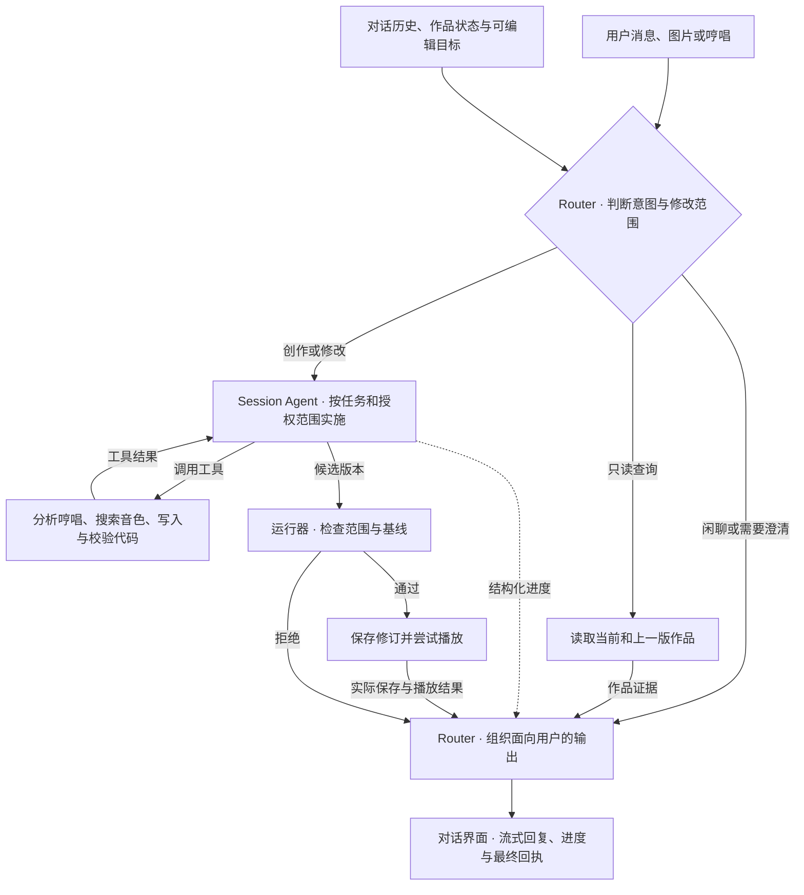

# oddeNova Router 与 Session Agent 架构

Router 是正式对话和本地调试页的唯一对话出口。它处理每条用户消息，负责理解意图、确认目标、选择改动范围和组织回复。Session 接收 Router 已经明确的实施任务，仅在授权范围内选择音乐实现和调用工具。

## 一轮如何运行

1. 运行器保存原始消息，取得当前代码、版本、历史和附件引用。重试沿用目标用户消息 ID。Router 读取这些资料和可编辑目标清单。心情生成同样经过 Router，AirJelly 上下文作为实施参考交给 Session。离线演示使用预设 Router 决策。
2. Router 直接回复、请求只读查询，或通过 `executeSession` 授权一项明确的音乐任务。只读证据含当前和上一版本，Router 根据证据作答。
3. Session 读取实施说明、授权范围、基线代码及附件参考。它能选择具体编排、检索采样、分析哼唱、修正候选和验证。意图、澄清、范围升级和给用户的选项由 Router 决定。
4. 范围验证与音乐代码验证通过后，运行器检查当前回合、用户消息和版本基线，再保存修订。当前会话尝试播放。回执按同一修订 ID 更新真实的播放结果。
5. 简单回执由 Router 层根据授权范围和结果生成。需要说明取舍、分步选项或范围冲突时，Router 根据结构化状态和可核对的版本证据撰写回复。综合回复失败时显示标准回执。Session 的文字说明留在调试记录。

## 改动授权

| 范围 | Router 可授权的工作 | 实施检查 |
|---|---|---|
| `create` | 在空作品中创作 | 基线必须为空 |
| `rewrite` | 用户要求重做或修改整首 | 必须有现有作品 |
| `add_layers` | 在可识别的 `stack` 末尾添加声部 | 原有声部、顺序和外部源码保持原样 |
| `layers` | 编辑列出的声部 | 校验选中表达式之外的源码与基线一致 |
| `section` | 编辑列出的 `arrange` 段落 | 保留段落时长和其他源码 |
| `parameter` | 调整选中声部的一个参数，如 `gain` | 仅允许修改指定链式方法，值为数字。其他方法和所在顺序保持 |
| `tempo` | 修改现有速度设置 | 仅允许修改单一 `setcps` 或 `setcpm` 的数值表达式 |

Router 使用当前版本提供的目标 ID。目标不明确或超出可识别结构时，Router 先询问。首版支持 `stack`、Strudel 标签声部、可定位的 `arrange` 段落和单一速度调用。依靠动态 JavaScript 或共享表达式实现的段落可能无法定位。范围校验保证这些受支持结构的源码边界，听感和动态代码的完整语义仍取决于实施结果。

`setCode` 检查候选后才更新工具内的草稿。显式提交与返回给运行器的候选还会检查范围。检查失败可在同一范围内修正，越界版本不会保存或播放。概率模型负责判断用户授权的软件含义，范围验证负责落实该授权。

## 对话与诊断

- Router 的用户回复、四类进度和执行回执进入对话。
- Session 的流式推理、实施旁白、工具参数及返回错误沿内部通道处理。用户停止后，未提交的候选丢弃，已经保存的回执仍可读。
- `/local-tools/agent-workflow` 左侧运行与产品一致的对话边界。右侧展示实际的委派、模型与工具调用、范围拒绝、提交、播放和回执。模型原生推理字段留在 provider 协议内部。
- 历史会话保留已保存的记录。此边界适用于新回合。会话和代码的存储结构继续支持历史修订、撤销和重放。

## 思考期间的四类进度

| 类型 | 事实来源 | 对话呈现 |
|---|---|---|
| 规划 | 附件预处理、曲式规划、音色搜索，或 Session 通过 reportArrangement 声明下一步 | 一句具体的行动与听感目标 |
| 工具 | 实际调用及结果，如哼唱分析、采样查询、写入草稿和验证 | 工具图标和操作标题，展开查看调用细节 |
| 构思 | Session 单独提交的音乐决策摘要，涵盖配器、调性、曲式和结构选择 | “构思”和本次决策的耗时，展开查看独立文本窗 |
| 实操 | setCode 接受草稿后比较修改前后的声部或可识别段落 | 回复时把操作标题放到顶部，具体操作直接显示。结束后汇入一个“编曲”折叠模块 |

新回合开始时，用户气泡和阶段动画一起向上滚动。内容超出可见区域后，对话跟随输出末尾，阶段动画吸顶。工具和构思在回复时展开。回合完成后，进度统一收在「思考过程」内，校验、写码和提交等代码工具归到其中的「完成」。Router 撰写用户回复时可以流式预览，阶段和预览文本只在当前回合内保留。

Session 报告选择及取舍，Router 将其改写成面向用户的短摘要。实际参数与操作从草稿差异获得，保存在实操项。模型原生推理仍在模型协议内处理。Router 对事件分批、按发生顺序呈现，进度生成和 Session 实施并行。进度请求失败或回合取消时，未发布的更新会丢弃，最终回执继续按执行结果处理。

路由判断、范围授权和 Session 系统提示使用中性指令。Router 撰写用户回复、进度和综合答复时加载完整 Persona。内置角色按应用语言加载，自定义角色使用保存的提示词。纯对话先获得中性草稿，最终回复以用户当下的意图为准。简单问候留给用户开启话题。表达请求失败时使用草稿，工作流查看器会记录这次回退。

## 代码位置

- `src/agent/router.ts` 与 `src/prompts/router.ts` 负责路由协议和对话。
- `src/agent/session-scope.ts` 负责源码范围检查，`src/prompts/session-execution.ts` 描述实施职责。
- `src/services/llm.ts` 构造实施任务和回执所需证据。
- `src/hooks/useAgentRunner.ts` 管理对话发布、取消、提交和播放，`src/agent/router-presentation.ts` 生成标准回执。
- `src/agent/router-progress.ts` 根据内部事实组织用户进度，`RouterProgressView.tsx` 渲染四类进度。

## 验收

| 场景 | 预期结果 |
|---|---|
| “鼓轻一点会怎样？” | Router 直接回复，不执行修改 |
| “只降低底鼓音量” | 当授权为 `parameter` 时，只能调整目标声部的 `gain` |
| “副歌更有冲击力” | 授权明确的段落，其他段落与时长受保护 |
| “刚才副歌多了什么？” | 查阅作品证据后答复，不产生修订 |
| Session 发送原生推理或任意警告文本 | 左侧对话只显示 Router 状态和回执 |
| 候选改了非授权声部、段落或参数 | 不保存、不播放，Router 说明冲突 |
| 已保存但播放失败或综合答复失败 | 保留同一修订，显示准确的回执 |
